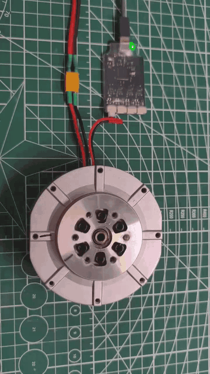
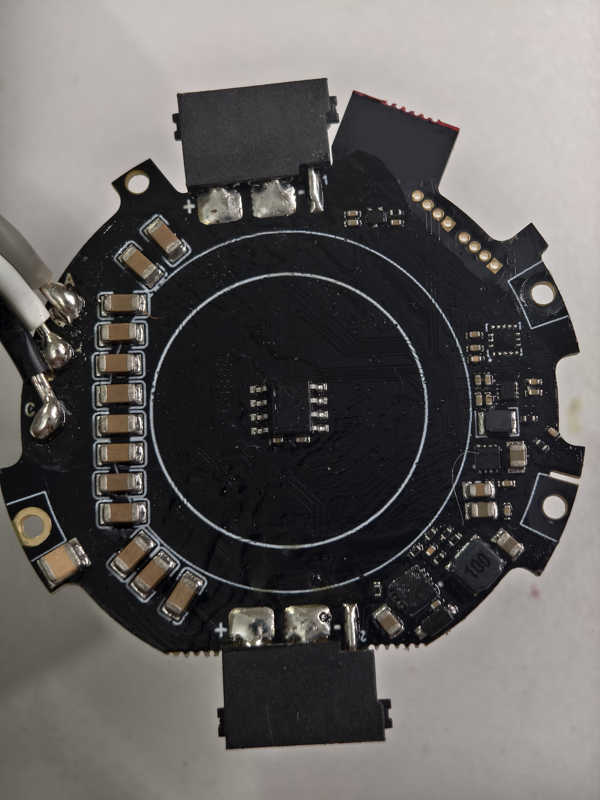
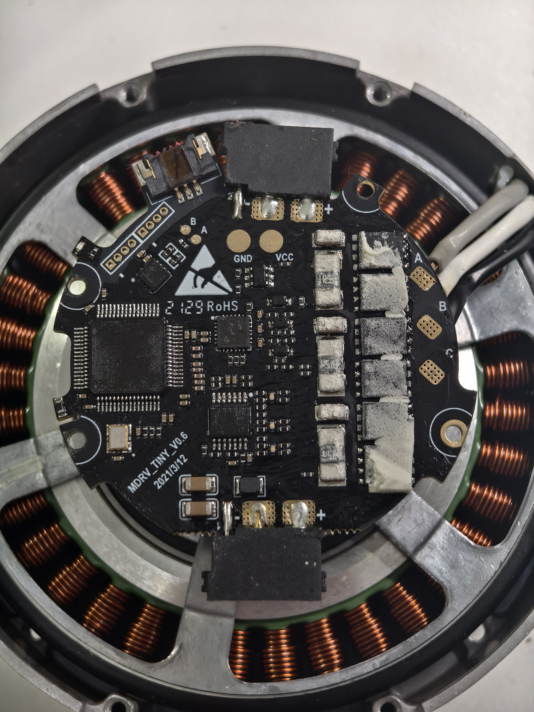

# 从 CRC 到转起来：一颗宇树 Go1 拆机电机的通信与控制记录

> 测试时间：2026 年 11 月 23—24 日。这篇记录的是我手上这颗宇树go1拆机电机的折腾过程，协议和测试结果以这颗样本为准。

## 买错电机了

本来以为买到的是 **Go2 拆机电机**，想着应该和零售的 **GO-M8010-6** 比较接近，就先按照 8010 的协议组帧、修改 CRC，一边检查串口、波特率和 ID，一边反复尝试。结果怎么试都不通。

后来把电机拆开，看了 PCB，又对照开源资料和实际跑通的协议，才发现买到的更像是 **Go1 的拆机电机**。我暂时还没发现能从电机外观直接区分 Go1、Go2 的可靠方法，所以如果也准备买拆机件，最好让卖家说明来源，别像我一样拿到手就按 8010 的协议一顿折腾。单凭这块 PCB 和通信格式，还不能把具体型号和固件版本完全确定下来。

后面参考 Go1 的开源项目和宇树 A1/B1 的帧格式，重新处理 CRC32，终于在 4.8 Mbps 下收到回复，把电机转起来了。

这是电机测试的视频，转换成 GIF 放在这里：



## 拆开看了看 PCB

先放两张板子的照片，方便对照：





背面能看到 `MDRY_TINY_V0.6` 和 `2021/3/12` 的丝印。整体看起来是比较典型的无刷电机驱动结构：**STM32 主控、三相 FOC 栅极驱动、电流采样运放、三路采样电阻和 6 个 MOS**；正面中间还有一颗 8 pin磁编码器。电源部分看布局也像是 **Buck 降压＋LDO** 的组合。

这些是根据板子布局和器件外形做的初步判断，驱动芯片、运放、磁编以及电源芯片的具体型号还没有核实。主要芯片都磨过！！！（unitree一贯的风格）真要细查的话，可以再根据封装、引脚和走线慢慢猜。不过这颗电机本来就不是我的目标电机，我也就没在这里继续花功夫。

倒是用探针接了一下 **STM32CubeProgrammer**，日志读到了：

```text
Device ID: 0x413
```

我猜它可能是和 ODrive 一样的 STM32F405RGT6。板子上还有一处看起来很像 IMU 的芯片焊盘，我猜可能是 A1 电机上陀螺仪的位置，在这个版本减配了。不过这只是看布局的猜测，还没有追线或对照 BOM，先留个疑问。

## 先说结果

| 项目 | 本次这颗电机的结果 |
| --- | --- |
| 供电与设备 | 24 V，固定的裸电机；FT4232H USB 转 RS-485 的 `/dev/ttyUSB0` |
| 串口配置 | **4,800,000 bps，8N1，无流控** |
| 运动控制协议 | 主机发 **34 字节**，电机回 **78 字节**；两方向包头均为 `FE EE` |
| CRC | 主机命令、反馈均采用本次验证通过的 **CRC32**，计算范围不同 |
| 运动模式 | `mode=0` 停止；`mode=10` 用参数组合实现 FOC 控制 |
| 稳定通信 | 4.8 Mbps 下两轮停止查询分别收到 **20/20、100/100** 个 CRC 正确回复 |
| 转速测试 | 空载输出端目标约 1 圈/秒，保持 60 秒；稳态平均 **0.9990 圈/秒**，**3314/3314** 次收发有效 |
| 修改 ID | 经 `mode=11` 手动拨档、`mode=0` 保存，实测改号成功；末次查询为 ID 1 |

这不是对电机额定力矩、负载能力或所有批次兼容性的认证。尤其注意：零售 GO-M8010-6 文档里的 **17 字节命令、16 字节回复、CRC16、4 Mbps**，与本文这颗电机实测的运动控制帧不是同一种格式。

## 一、为什么最开始一直不通？

最初的假设是：拆机电机可能与零售 GO-M8010-6 一样。按这个方向检查 RS-485、波特率、ID、CRC 和工厂模式，但零售 8010 的控制帧在这颗电机上没有得到可用回复。

这时参考了两个开源项目：

1. [gooddawg](https://github.com/irisblooom/gooddawg)：作者展示了如何脱离机身控制 Go1 机器狗腿。我们重点参考了它的 [Go1 组帧和 CRC 实现](https://github.com/irisblooom/gooddawg/blob/main/build_a_packet.py)。
2. [AATB 的 unitree_crc](https://github.com/aatb-ch/unitree_crc)：提供 Go1、Go2 等电机的 CRC 验证代码，其中 [Go1 示例](https://github.com/aatb-ch/unitree_crc/blob/main/src/aatb_go1_crc.cpp)带有已抓取的命令帧及预期 CRC。

这里必须把功劳说清楚：**我们没有从零独立破解 CRC，也没有把 gooddawg 整套程序直接当作 SDK 运行**。我们的工作是在已有开源线索上，自己编写探测和控制程序，结合这颗电机的真实收发、官方 A1/B1 结构定义和现场运动反馈，验证哪套格式能工作。

## 二、CRC32 是怎样确定的？

### 1. 先用公开抓包做离线验证

AATB 的 Go1 示例提供了一条 34 字节命令，末尾预期 CRC 是 `B0 28 33 B2`：

```text
FE EE 00 15 00 FF FF 00 00 00 20 42 10 00 FF 7F
80 5C E9 7F 14 00 00 04 05 00 00 00 00 00 B0 28 33 B2
```

gooddawg 和 AATB 的实现指向同一个关键点：**不要对整包按普通字节序调用默认 CRC32**，而是把前 28 字节作为 7 个小端 `uint32`，每个字从高位开始处理。结果按小端写回。

| CRC 参数 | 本次使用方式 |
| --- | --- |
| 宽度 / 多项式 | 32 位，`0x04C11DB7` |
| 初始值 | `0xFFFFFFFF` |
| 运算方式 | 先读小端 32 位字，字内从最高位开始移位 |
| 最终异或 | 无 |
| 发送帧 | 计算字节 `0～27`，CRC 存于 `30～33` |
| 反馈帧 | 计算字节 `0～71`，CRC 存于 `74～77` |

**特别容易忽略：CRC 前面的两个字节没有包含在 CRC 覆盖范围内。** 发送帧 `28～29`、反馈帧 `72～73` 位于 CRC 前，但不是上述计算输入。

下面是我们使用的核心算法，输入必须是 4 字节对齐的长度：

```python
import struct

def crc32_words(data: bytes) -> int:
    if len(data) % 4:
        raise ValueError("CRC 数据长度必须是 4 的倍数")
    crc = 0xFFFFFFFF
    for (word,) in struct.iter_unpack("<I", data):
        crc ^= word
        for _ in range(32):
            crc = ((crc << 1) ^ (0x04C11DB7 if crc & 0x80000000 else 0)) & 0xFFFFFFFF
    return crc

captured = bytes.fromhex(
    "feee001500ffff00000020421000ff7f805ce97f14000004050000000000b02833b2"
)
assert crc32_words(captured[:28]).to_bytes(4, "little") == captured[30:34]
```

这一步验证的是：**算法能复现公开抓包里的 CRC**。它还不证明自己的串口配置、接线或这颗电机已经正确通信。

### 2. 再用电机的真实回复验证

以 ID 1、停止模式发送的本机命令帧为：

```text
FE EE 01 BA 00 FF 00 00 00 00 00 00 00 00 00 00
00 00 00 00 00 00 00 00 02 00 00 00 00 00 D8 10 64 75
```

帧中控制量均为零，最后 `D8 10 64 75` 是按上述规则计算并小端写入的 CRC。随后从电机收到 78 字节回复，按反馈帧的 CRC 覆盖范围校验成功，并读到 ID、模式、温度、错误码和位置。4.8 Mbps 下做了 20 次和 100 次重复停止查询，全部收到有效回复。

这比“串口收到字节”更可靠：同时确认了包头、长度、ID 和反馈 CRC。首次通信记录和原始日志保存在本机诊断目录。

## 三、怎样把 A1 帧对齐到这颗拆机电机？

我们把实测帧与宇树官方 [A1/B1 数据结构定义](https://github.com/unitreerobotics/unitree_actuator_sdk/blob/main/include/unitreeMotor/include/motor_msg_A1B1.h)逐字节对照。下面的“对齐”指**字段布局和部分行为经过这颗电机的实测支持**，不代表官方保证所有固件完全兼容，也不意味着它就是零售 A1。

### 主机发送：34 字节

| 字节 | 官方 A1/B1 结构中的含义 | 本次拆机电机的用法与验证 |
| --- | --- | --- |
| `0～1` | 帧头 | `FE EE` |
| `2` | 电机 ID | 本次使用过 0、1、2 |
| `3` | 保留字节 | 本次发送 `BA`；不把它描述为所有 A1 帧的固定值 |
| `4` | `mode` | `0` 停止，`10` FOC；`11` 用于本机拨轮改号 |
| `5` | `ModifyBit` | 本次为 `FF`，不通过普通控制帧修改参数 |
| `6～11` | 读取／修改及保留字段 | 本次普通测试设零 |
| `12～13` | `T`，int16，小端 | 力矩编码：转子侧值 × 256 |
| `14～15` | `W`，int16，小端 | 速度编码：转子侧 rad/s × 128 |
| `16～19` | `Pos`，int32，小端 | 位置编码：转子侧 rad × 16384 / 2π |
| `20～21` | `K_P`，int16，小端 | 线协议系数 × 2048 |
| `22～23` | `K_W`，int16，小端 | 线协议系数 × 1024 |
| `24～29` | 低频命令与保留字段 | 本次 `24=02`，其余为零 |
| `30～33` | CRC32 | 计算前 28 字节，结果小端写入 |

### 电机反馈：78 字节

| 字节 | A1/B1 结构及本机解析 |
| --- | --- |
| `0～1` | `FE EE` 包头 |
| `2` | 电机 ID |
| `4` | 当前模式 |
| `6` | 温度，int8 |
| `7` | 错误码 |
| `12～13` | 力矩原始值，int16 |
| `14～15` | 高速速度原始值，int16 |
| `16～19` | `LW`，低速速度字段，float32 |
| `30～33` | 转子位置原始值，int32 |
| `74～77` | CRC32，覆盖前 72 字节 |

其余反馈字段的结构可参照官方 A1/B1 头文件；本文没有逐项验证每个传感器字段。连续转动过程中，本机还观察到位置计数约按 **2²³** 回绕，以及回绕附近 `LW` 异常尖峰，不能简单假设每种固件都按 32 位自然回绕或始终依赖 `LW` 做安全测速。

### 控制模式其实是同一个 FOC 帧里的不同参数组合

A1 风格协议中，位置、速度、阻尼、力矩、零力矩、混合控制主要是 `mode=10` 下的字段组合，而不是六个不同模式号。例如：速度控制通常使用 `KP=0`，给定 `W`、设置 `KW`；阻尼则把目标 `W` 设为零。`mode=0` 用于停止。

本次先做小幅测试，再做 ±10° 的位置跟踪、速度、阻尼、短时力矩脉冲、零力矩和混合控制。**零力矩测试说明该组合下可以接近零力矩反馈，但并未证实这颗拆机固件具备零售教程所述的主动摩擦补偿。** 参数与结果详见本机保存的测试记录。

## 四、1 秒一圈：不要直接拿A1减速比套用

我们不知道这颗电机的准确减速比，便先在停止状态手动转动输出轴恰好一圈。编码器记录从 `18299` 变到 `122094`，增量 **103795 counts / 输出圈**。

若按 A1 格式的 **16384 counts / 转子圈**理解，折算比约 `103795 / 16384 = 6.335`。基本上和零售的GO-M8010减速比一致。

后续空载速度测试中，名义目标约 1 圈/秒，先测得约 0.949 圈/秒；对速度指令作 **1.05 倍经验补偿**后，短时保持段约 0.997 圈/秒。修复回绕处理后，又用 FT4232H 做了 60 秒恒速段：

- 稳态平均 **0.9990 圈/秒**，范围约 **0.9921～1.0074 圈/秒**。
- 3314 次发送和 3314 个有效回复；温度 40～41°C，错误码 0。
- 初始、计划结束与最终停止均收到 `mode=0` 确认。

这是 **24 V、裸电机、空载**下的一次有界试验，不是额定转速、长时间带载能力或通用补偿系数。首轮长测曾因为计数回绕触发保护而提前停止，修正回绕处理后才完成 60 秒；这段失败同样记录在日志里。

## 五、踩过的坑

### CH343P：这套转换器在 4.8 Mbps 没跑通

我们使用过 CH343P＋SIT3088 的 USB 转 RS-485 转换器。当时设备以 `/dev/ttyACM0`、`cdc_acm` 驱动识别。在请求 **4.8 Mbps** 时出现发送超时、没有收到电机有效回复；重插后问题仍在。

后来把 CH343 转换器和 FT4232H 并接，同一时刻只允许一只发送，另一只监听。两者在 **4 Mbps 和 6 Mbps** 下都能双向传递完整的 34 字节测试帧；在请求 **4.8 Mbps** 时，FT4232H 可以正常与电机通信，而 CH343 路径没有正确还原通信。

因此，**本次这只 CH343P＋SIT3088 设备、当前 CDC 配置在 4.8 Mbps 没有完成电机通信**，换 FT4232H 后成功。不能仅凭这次结果断言所有 CH343P 板卡、固件或驱动都不支持精确 4.8 Mbps：当时没有用示波器测实际线速。沁恒官方 [Linux 驱动分频代码](https://github.com/WCHSoftGroup/ch343ser_linux/blob/main/driver/ch343.c)提供了值得调查的分频线索，但不等于本机 CDC 固件的实测波特率。

另外，FT4232H 请求 5 Mbps 时，本机两次分别只收到 10/20、11/20 个有效回复；请求 4.8 Mbps 时连续获得 120/120。选择适配器时，**标称最高速率与能否准确产生目标速率是两回事**。

### 拨轮改 ID：阻力大，不代表不能转

[官方 A1/B1 改号示例](https://github.com/unitreerobotics/unitree_actuator_sdk/blob/main/example/changeID.cpp)提供的思路是进入 `mode=11` 后转动输出轴选档，再发送 `mode=0` 保存。最初手动尝试时阻力很大、分档感不清晰，我们一度认为可能无法拨动；后来实际操作证明，**这颗电机在该模式下可以转动并完成改号**。不要因为阻力存在就断定它没有进入模式，也不要在档位不清时硬拧。

本次先定向收到 ID 1 的 `mode=11` 有效回复，人工拨档并保存后查到 ID 2；随后断电约 3 秒重启，ID 2 仍有 10/10 有效停止反馈，证明这一次改号跨断电保留。后来又做了几次试验：

| 操作 | 保存后实际查询 |
| --- | --- |
| 从 ID 2 进入，确认拨一档 | ID 0 |
| 从 ID 0 进入，确认拨三档 | ID 2 |
| 从 ID 2 进入，确认拨五档 | ID 1 |

这些结果与“拨档选择在 0、1、2 间重复”的部分预期相符，所以该固件就是和原版宇树A1的拨轮在0-1-2之间变id一样。

还有一个细节：保存之后紧接着扫描有时会短暂无回复，稍等后再查才收到结果；这只能说明当时有静默窗口，不能据此认定电机一定重启了。

### 不能把 8010 的工厂工具直接当成通用改号工具

我们还试过零售 8010 的 `swboot`、不同速率的入口及上电窗口，没有与这颗拆机电机建立工厂模式通信；因此没有发送猜测性的工厂写 ID 命令。这是**本次没有跑通**，不代表这颗电机永远不存在其他配置入口。

## 六、后来封装成了 SDK

基于这些实测记录，我们整理了 [Go1 拆机电机 SDK](README.md)，提供：

- Python：`MotorCmd`、`MotorData`、`SerialPort.sendRecv`。
- Linux C++：对应风格的命令、反馈和串口接口。
- STM32 C：可移植帧编码、解析、CRC、收发回调和 HAL 移植模板。

新 Python 和 C++ SDK 各对本机 ID 1 做过一次停止查询，反馈均为 `mode=0`、42°C、错误码 0；真实历史帧、CRC 错误、回显、碎片和超时也做了离线测试。**新封装的非零运动命令及 STM32 实板尚未完成验证**，它们不是宇树官方发布的驱动。

实际使用时，先确认机械固定、供电和线束、ID、限位与可靠断电条件；从停止查询和低能量开始，并由应用程序处理超时、错误、温度、行程和失联停止。附带的 `stop.py` / `go1_stop` 会真实发送停止帧，运动控制示例则需要根据自己的机构独立设定参数。

## 参考资料与原始记录

- [gooddawg：Go1 拆机腿控制及组帧](https://github.com/irisblooom/gooddawg)
- [AATB：Unitree 电机 CRC 验证](https://github.com/aatb-ch/unitree_crc)
- [宇树官方 actuator SDK](https://github.com/unitreerobotics/unitree_actuator_sdk)
- [官方 A1/B1 帧结构](https://github.com/unitreerobotics/unitree_actuator_sdk/blob/main/include/unitreeMotor/include/motor_msg_A1B1.h)
- [官方 A1/B1 改号示例](https://github.com/unitreerobotics/unitree_actuator_sdk/blob/main/example/changeID.cpp)
- 本机通信、模式、适配器、长测和改号记录保存在本地诊断目录。
- [SDK 使用说明](README.md)
